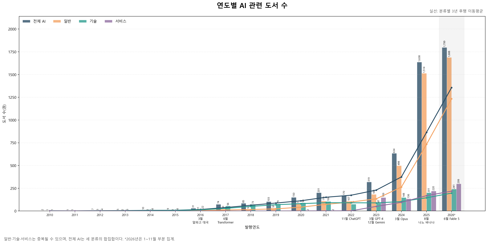
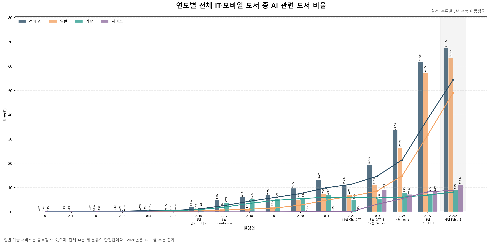
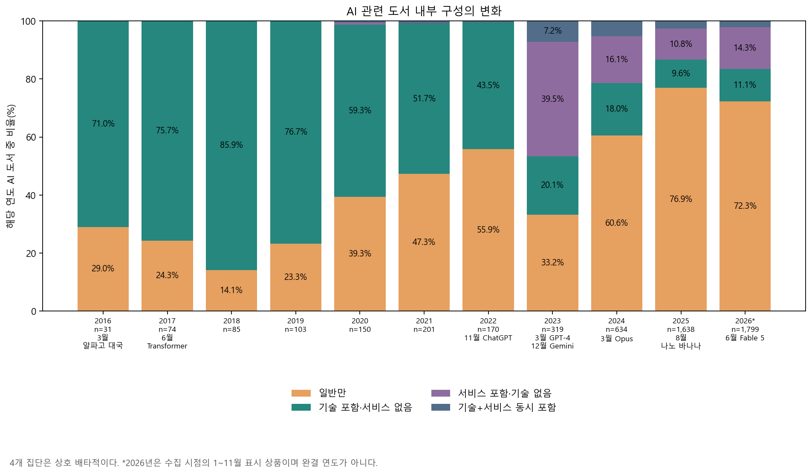
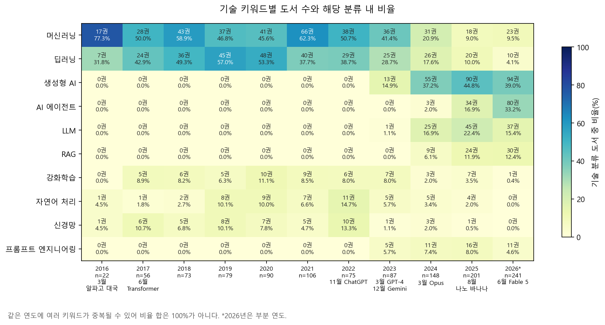
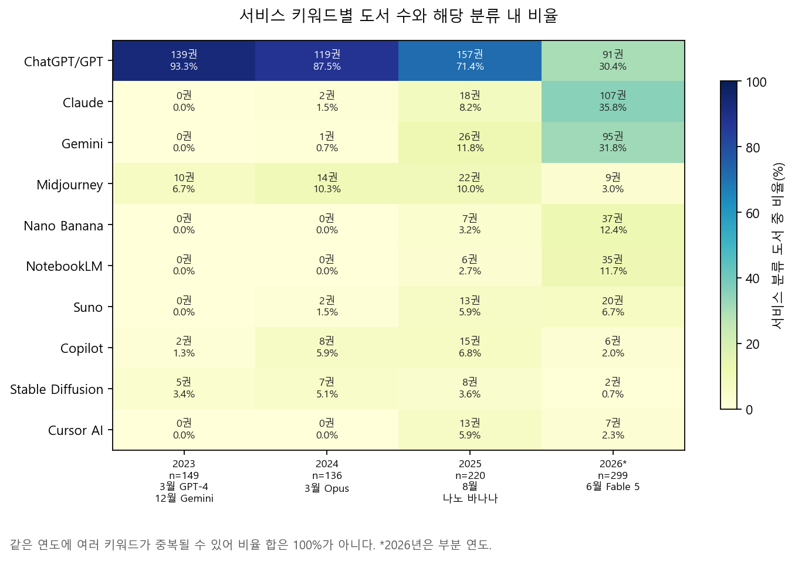
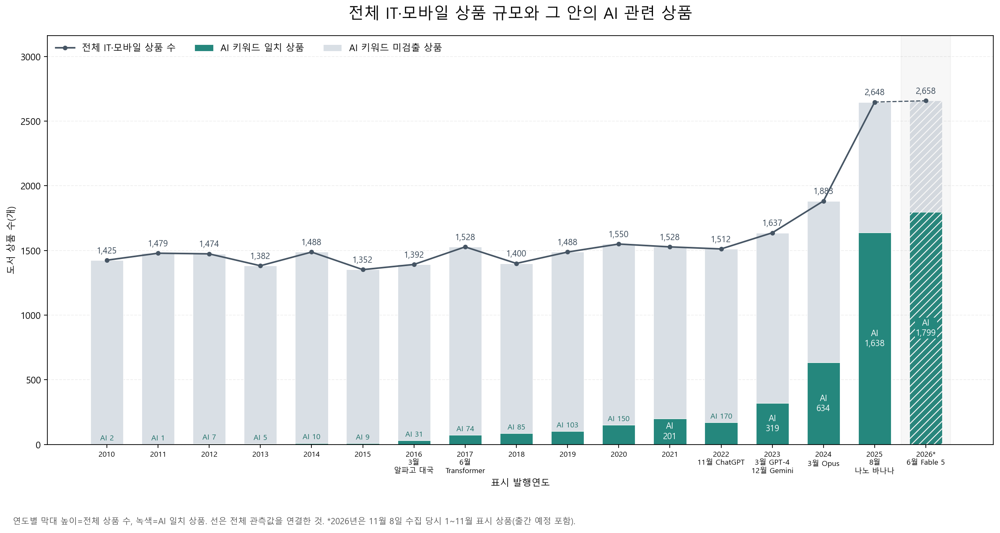
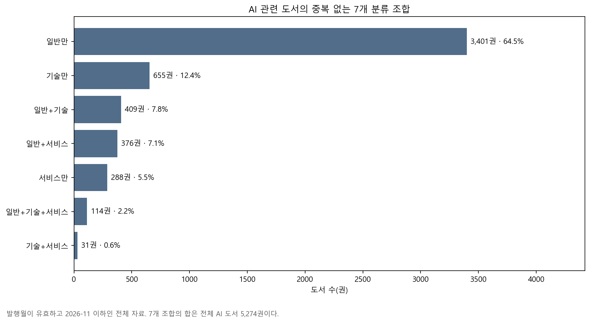

# IT 기술 트렌드의 논문-도서 반영 시차 분석

## 1. 개요

## 2. 데이터

### 2.1 현재 데이터 명세

| 항목 | 내용 |
|---|---|
| 파일 | `class3/data/yes24_it_mobile_list.csv` |
| 수집 대상 | 예스24 `국내도서 > IT 모바일` 및 하위 분류의 목록 상품 |
| 관측 단위 | 도서 상품 1개 |
| 수집일 | 2026-11-08 |
| 데이터 크기 | 46,081행, 18열 |
| 기본키 | `product_id`(중복 0건) |
| 발행월 범위 | 1980-01~2027-02 |

### 2.2 수집 컬럼

| 구분 | 컬럼 |
|---|---|
| 상품 식별 | `product_id`, `product_url` |
| 도서 정보 | `title`, `subtitle`, `contributors`, `publisher` |
| 발행 정보 | `publication_month`, `publication_date_raw` |
| 가격 정보 | `list_price`, `sale_price`, `discount_rate`, `points` |
| 독자 반응 | `average_rating`, `rating_count`, `sales_index` |

### 2.3 사용 컬럼

| 사용 목적 | 원본 컬럼 | 처리 방법 |
|---|---|---|
| 기술 주제 분류 | `title`, `subtitle` | 제목과 부제를 결합하여 기술 주제 판별 |
| 시간별 추세 | `publication_month` | 연도·월·분기 단위 집계 |

### 2.4 분석 대상 선정 및 표시 기간

| 단계 | 처리 기준 | 남은 상품 수 |
|---|---|---:|
| 수집 원자료 | 목록 완본 전체 | 46,081 |
| 발행월 확인 | 발행월 누락 30건 제외 | 46,051 |
| 수집월 기준 제한 | 2026년 12월 이후 상품 15건 제외 | 46,036 |

유효 자료는 AI 여부와 관계없이 모두 보존하며, 연도별 전체 IT 상품 수의 분모로 사용한다. 2026년은 11월 8일 수집 당시 발행월이 1~11월로 표시된 상품으로, 11월 중 출간 예정도 포함될 수 있다.

전체 유효 자료를 집계한 결과, **2010년 이전 AI 키워드 일치 상품은 총 36건으로 관측 연도별 0~4건**이었다. 초기의 드문 관측보다 이후 증가 양상을 읽기 쉽도록 기본 추이 그림은 2010년 이후를 표시한다. 2010~2015년의 연간 1~10건도 포함해 증가 전의 낮은 수준을 비교한다. 이는 2010년을 성장의 시작이나 통계적 전환점으로 판정했다는 뜻은 아니다.

| 분석 | 표시·집계 기간 | 선택 이유 |
|---|---|---|
| 3.2 권수·3.3 비율·3.7 전체 규모 | 2010~2026년 | 2010년 이전 AI 관측은 드물어 이후 흐름을 확대하되, 증가 전 구간도 함께 표시 |
| 3.4 구성 | 2016~2026년 | 3.2에서 확인한 AI 상품 규모 증가 이후의 내부 구성을 자세히 표시 |
| 3.5 기술 키워드 | 2016~2026년 | 3.2의 기술 분류가 2015년 8건에서 2016년 22건, 2017년 56건으로 늘어, 그 이후의 키워드 구성을 비교 |
| 3.6 서비스 키워드 | 2023~2026년 | 3.4에서 서비스 포함 집단이 2023년 149건으로 확대된 것을 확인해 이름별 비교 구간으로 선택. 이전에는 누적 5건 |
| 부록 A 분류 중복 | 유효 자료 전체(1980~2026년) | 플래그 간 관계는 전체 자료로 확인 |

표시 기간은 관측 분포와 가독성을 고려한 탐색적 선택이며 통계 검정으로 정한 경계가 아니다. 이전 연도는 원자료와 연도별 집계에서 삭제하지 않았다. 아래 비율은 판매량이 아니라 현재 목록의 상품 수를 기준으로 한다.

## 3. 본론

### 3.1 분석 기준

도서 제목과 부제를 결합한 뒤 키워드에 따라 일반·기술·서비스로 분류했다. 한 도서가 여러 분류에 동시에 포함될 수 있으며, 전체 AI 도서 수는 세 분류를 더한 값이 아니라 중복을 제거한 합집합이다.

| 분류 | 판정 기준 | 검색 키워드 |
|---|---|---|
| 전체 AI | 일반·기술·서비스 중 하나 이상에 해당 | 세 분류의 합집합 |
| 일반 | 인공지능을 통칭하는 표현이 있음 | 인공지능, Artificial Intelligence, AI, A.I. |
| 기술 | AI의 방법·구조·응용 기술을 가리키는 표현이 있음 | 생성형 AI, 머신러닝·기계학습, 딥러닝, LLM·거대/대규모 언어 모델, 신경망, 강화학습, 자연어 처리·NLP, 컴퓨터 비전, Transformer, RAG·검색 증강 생성, 프롬프트 엔지니어링, AI 에이전트·에이전틱 AI, 확산 모델 |
| 서비스 | 특정 AI 서비스·제품·모델명이 있음 | ChatGPT·GPT, Gemini, Claude, Copilot, Midjourney, Stable Diffusion, Suno, NotebookLM 등 |

‘일반’은 책의 난이도나 독자층을 뜻하지 않는다. 예를 들어 『AI와 ChatGPT』는 일반과 서비스에 모두 포함되지만 전체 AI에서는 1권으로 센다. 영문은 대소문자를 구분하지 않으며, 한글·영문 표기 변형과 오탐 방지 조건은 [키워드 사전](../ai_keywords.json)에 정의했다. 서비스 행은 대표 예시이며 전체 검색어도 이 사전에서 확인할 수 있다.

**공통 AI 판정:** 제목+부제에서 같은 키워드 사전의 일반·기술·서비스 중 하나 이상이 검출된 상품을 AI 관련 도서로 본다. 모든 연도에 같은 사전과 검색 규칙을 적용하며, 분석별로 키워드를 추가하거나 바꾸지 않았다. 아래에서 달라지는 것은 주로 분석 대상의 부분집합과 비율의 분모다.

| 분석 | AI 판정 및 집계 대상 | 비율의 분모 |
|---|---|---|
| 3.2 도서 수 | 공통 판정의 전체 AI와 세 분류 | 없음(권수) |
| 3.3 도서 비율 | 공통 판정의 전체 AI와 세 분류 | 해당 연도 전체 분석 대상 IT 도서 |
| 3.4 구성 변화 | 공통 판정 결과를 겹치지 않는 4개 집단으로 구분 | 해당 연도 전체 AI 도서 |
| 3.5 기술 키워드 | 공통 판정 중 기술 분류에 해당하는 도서 | 해당 연도 기술 분류 도서 |
| 3.6 서비스 키워드 | 공통 판정 중 서비스 분류에 해당하는 도서 | 해당 연도 서비스 분류 도서 |
| 3.7 전체 규모와 AI | 공통 판정의 AI 도서와 나머지 도서를 한 막대로 누적 | 막대 높이는 해당 연도 전체 IT 도서 수. AI 비율도 같은 전체가 분모 |
| 부록 A 중복 | 공통 판정 결과를 7개 조합으로 구분 | 전체 AI 도서. 조건부 중복률은 기준으로 삼은 분류의 도서 수 |

3.6절의 ChatGPT/GPT 통합은 서비스 내부 이름을 묶는 처리이며 AI 도서 포함 여부는 바꾸지 않는다. 3.2~3.7의 기본 분석은 같은 검색 범위와 상품 포함 기준을 사용한다. 제목만 검색하거나 큰글자·세트 상품을 제외한 민감도 결과는 [검토 메모의 보조 검토](analysis_review_notes.md)에 보존했으며 기본 집계에 섞지 않는다.

분석 대상과 그림별 기간은 2.4절에 정리했다. 3.2·3.3의 막대는 해당 연도의 관측값이고 실선은 분류별 3년 후행 이동평균이다.

**주요 사건 표시:** 모든 시계열 그림의 연도 아래에 다음 사건을 같은 기준으로 표시했다. 표본 수가 있는 그림은 `연도 → n → 사건` 순서이며, 표시 기간 밖의 사건은 넣지 않았다. 같은 해의 사건은 월순으로 나열하고 긴 표기는 월과 이름을 두 줄로 나눈다. 사건은 시점을 비교하기 위한 참고이며 도서 증감의 원인으로 판정한 것은 아니다.

| 시점 | 사건·공식 출처 | 그림의 짧은 표기 |
|---|---|---|
| 2016.03 | [알파고–이세돌 대국](https://deepmind.google/research/alphago/) | 3월 알파고 대국 |
| 2017.06 | [Transformer 논문 공개](https://arxiv.org/abs/1706.03762) | 6월 Transformer |
| 2022.11 | [ChatGPT 공개](https://openai.com/index/chatgpt/) | 11월 ChatGPT |
| 2023.03 | [GPT-4 발표](https://openai.com/index/gpt-4-research/) | 3월 GPT-4 |
| 2023.12 | [Gemini 모델 발표](https://blog.google/innovation-and-ai/technology/ai/google-gemini-ai/) | 12월 Gemini |
| 2024.03 | [Claude 3 Opus 공개](https://www.anthropic.com/research/claude-3-family) | 3월 Opus |
| 2025.08 | [Nano Banana 공개](https://blog.google/products-and-platforms/products/gemini/updated-image-editing-model/) | 8월 나노 바나나 |
| 2026.06 | [Claude Fable 5 공개](https://www.anthropic.com/news/claude-fable-5-mythos-5) | 6월 Fable 5 |

Gemini는 2024년 서비스 개칭이 아니라 2023년 모델 발표를, Opus는 첫 등장인 Claude 3 Opus를 기준으로 삼았다. 시간축이 없는 부록 A의 중복 그림에는 사건을 붙이지 않고 위 목록을 공통 참고로 둔다.

### 3.2 연도별 AI 관련 도서 수

전체 AI 관련 도서는 2023년 319권, 2024년 634권, 2025년 1,638권으로 증가했다. 2026년은 11월까지 1,799권이다.

### 3.3 연도별 AI 관련 도서 비율

전체 IT·모바일 도서 중 AI 관련 도서 비율은 2023년 19.5%, 2024년 33.7%, 2025년 61.9%로 증가했다. 2026년 부분 집계에서는 67.7%다.

### 3.4 AI 도서 내부 구성은 어떻게 바뀌었는가?

**목적:** AI 도서 증가와 함께 기술 표현 중심에서 일반 표현이나 서비스명 중심으로 제목의 구성이 달라졌는지 확인한다.

**사용 데이터:** 2016~2026년 AI 도서의 연도와 세 분류 플래그. 분모는 해당 연도의 AI 도서 수이며 전체 IT 도서 수와는 다르다.

**기간 선정 근거:** 3.2에서 확인한 2016년 이후의 AI 상품 규모 증가를 바탕으로, 증가한 상품이 어떤 키워드 조합으로 구성되는지 살펴본다. 초기의 적은 관측을 생략한 표시이며, 각 연도의 표본 수는 막대 아래에 함께 제시했다.

**방법:** 각 도서를 ‘일반만’, ‘기술 포함·서비스 없음’, ‘서비스 포함·기술 없음’, ‘기술·서비스 동시 포함’ 중 한 집단에 넣었다. 두 번째와 세 번째 집단은 일반 표현도 함께 포함할 수 있다. 네 집단의 합은 해당 연도 AI 도서 수와 같고, 비율 합은 100%다.

**결과:** 2018년에는 AI 85권 중 기술 포함·서비스 없음 집단이 73권(85.9%)이었다. 2023년에는 서비스 포함·기술 없음 집단이 126권(39.5%)으로 가장 컸다. 이후 일반만 집단은 2024년 384권(60.6%), 2025년 1,260권(76.9%)으로 커졌다. 2025년 기술 포함·서비스 없음 집단은 158권(9.6%), 서비스 포함·기술 없음 집단은 177권(10.8%)이었다.

2026년 부분 집계에서는 일반만 72.3%, 기술 포함·서비스 없음 11.1%, 서비스 포함·기술 없음 14.3%, 기술·서비스 동시 포함 2.3%였다.

**해석:** 현재 사전으로 관측한 변화는 기술 키워드가 중심이던 초기 구성, 2023년 서비스명 확대, 2024~2025년 일반 표현만 검출되는 상품의 대폭 증가 순서다. 이는 제목·부제의 구성 변화에 관한 결과다. 독자층의 대중화나 책의 기술적 깊이는 본문 자료 없이 단정할 수 없다. 큰글자책 등 상품 형태의 영향은 [검토 메모의 보조 검토](analysis_review_notes.md)에 보존했다.

상세 수치: [연도별 배타적 구성 CSV](analysis_results/ai_composition.csv)

### 3.5 기술 키워드의 중심은 어디로 이동했는가?

**목적:** AI 도서 전체의 확대 속에서 어떤 구체적인 기술 표현이 늘거나 줄었는지 살펴본다.

**사용 데이터:** 2016~2026년 기술 분류 도서의 `technical_keywords`. 분모는 해당 연도 기술 분류 도서 수이며 2018년 73권, 2025년 201권, 2026년 부분 집계 241권이다.

**기간 선정 근거:** 3.2의 기술 분류 상품은 2015년 8건에서 2016년 22건, 2017년 56건으로 늘었다. 기술명이 검출되는 상품의 규모가 커진 2016년 이후를 대상으로 구체적인 키워드 구성을 비교한다.

**방법:** 같은 책에서 같은 키워드가 반복되어도 키워드별 1권으로 셌다. 한 책이 여러 기술 키워드에 일치하는 것은 허용했다. 그림은 표시 기간의 누적 일치 도서 수 상위 10개 키워드이며, 색은 기술 분류 내 비율, 셀의 숫자는 권수와 비율이다. 전체 13개 기술 키워드는 CSV에 보존했다.

**결과:** 2018년 머신러닝은 43권(58.9%), 딥러닝은 36권(49.3%)이었다. 2025년에는 생성형 AI가 90권(44.8%), LLM이 45권(22.4%), AI 에이전트가 34권(16.9%), RAG가 24권(11.9%)이었다. 같은 해 머신러닝은 18권(9.0%), 딥러닝은 20권(10.0%)이었다.

2026년 부분 집계에서 AI 에이전트는 80권(33.2%), RAG는 30권(12.4%)으로 나타났다. LLM은 37권(15.4%)으로, 2025년과의 단순 연간 증감률 비교는 하지 않았다.

**해석:** 검출된 기술 표현의 중심이 머신러닝·딥러닝에서 생성형 AI, LLM, 에이전트, RAG로 넓어지는 흐름이 보인다. 기존 표현의 비율 감소는 해당 기술이 사라졌다는 뜻이 아니다. 새 책이 기존 기술을 다른 이름 아래 다룰 수 있으며, 제목에 표현이 없으면 현재 방식으로는 검출되지 않는다. 키워드별 비율을 더해 기술 도서 비중을 계산해서는 안 된다.

상세 수치: [기술·서비스 키워드별 연도 집계 CSV](analysis_results/ai_keyword_yearly.csv)

### 3.6 서비스 키워드는 특정 이름에 집중되어 있는가?

**목적:** AI 서비스 관련 도서가 ChatGPT 중심으로 유지되는지, 여러 서비스명을 다루는 방향으로 바뀌는지 확인한다.

**사용 데이터:** 2023~2026년 서비스 분류 도서의 `service_keywords`. 연도별 서비스 도서는 149권, 136권, 220권, 299권이며 마지막 해는 부분 집계다.

**기간 선정 근거:** 3.4에서 서비스가 포함된 두 집단을 합치면 2023년은 126+23=149건으로, 그해 AI 상품의 46.7%다. 2022년까지 서비스 분류 일치는 누적 5건이었으므로, 관측 규모가 크게 확대된 2023년 이후를 이름별 상세 비교 구간으로 삼았다. 서비스 관련 도서가 처음 등장한 해라는 뜻은 아니다.

**방법:** ChatGPT와 GPT는 같은 책에 함께 검출되는 경우가 많아 이 절에서만 ‘ChatGPT/GPT’ 계열로 합쳐 한 권으로 셌다. 원래 세 분류 플래그는 유지했다. 다른 서비스 사이의 중복은 허용했다. 그림은 표시 기간 누적 일치 도서 수 상위 10개 계열이며 분모는 해당 연도의 서비스 분류 도서 수다.

**결과:** ChatGPT/GPT 계열은 2023년 서비스 도서 149권 중 139권(93.3%), 2024년 136권 중 119권(87.5%), 2025년 220권 중 157권(71.4%)에서 검출됐다. 2025년 Gemini는 26권(11.8%), Claude는 18권(8.2%), Midjourney는 22권(10.0%)이었다.

2026년 부분 집계에서는 Claude 107권(35.8%), Gemini 95권(31.8%), ChatGPT/GPT 91권(30.4%)이었다. Nano Banana 37권(12.4%), NotebookLM 35권(11.7%)도 확인됐다. 한 책이 여러 계열에 포함되므로 이 비율들의 합은 100%를 넘을 수 있다.

**해석:** 현재 목록에서 관측되는 서비스명은 초기 ChatGPT/GPT 중심에서 여러 이름으로 넓어지는 모습이다. 이는 책의 제목·부제에서 차지하는 비중이며 서비스 사용량이나 시장점유율은 아니다. GPT 계열의 모델명도 포함하므로 ChatGPT 서비스만의 수치로 해석해서는 안 된다. 현재 키워드 사전에 없는 서비스는 반영되지 않으며, 2026년 순위는 완결 연도 결과와 구분한다.

상세 수치: [기술·서비스 키워드별 연도 집계 CSV](analysis_results/ai_keyword_yearly.csv)

### 3.7 전체 IT 도서 규모와 그 안의 AI 관련 상품은 어떻게 변했는가?

**목적:** 전체 IT·모바일 상품의 규모 변화와 그 안에서 AI 관련 상품이 확대되는 모습을 한 그림에서 확인한다. 여기서 ‘전체’는 수집한 IT·모바일 카테고리이며 모든 분야의 국내 도서시장 전체를 뜻하지 않는다.

**사용 데이터:** 2010~2026년의 연도별 전체 상품 수와 같은 키워드 기준으로 분류한 AI 일치·미검출 상품 수. 기존 기본 집계를 그대로 사용한다.

**방법:** 연도마다 막대 하나를 그리고 AI 일치 상품과 미검출 상품을 누적했다. 막대 전체 높이는 실제 전체 상품 수, 녹색 부분은 AI 상품 수다. 모든 막대를 100%로 맞추지 않았으므로 연도별 전체 규모 차이가 유지된다. 위쪽 숫자는 전체 상품 수, ‘AI’로 표시한 숫자는 AI 상품 수이며 선은 전체 관측값을 연결한다. 2026년은 사선과 별표로 표시하고 직전 연도와의 선을 점선으로 구분했다.

**결과:** 현재 목록에 남아 있는 상품을 발행연도로 나누면 2010~2022년 전체 규모는 연간 1,352~1,550개였다. 이후 2023년 1,637개, 2024년 1,883개, 2025년 2,648개로 커졌다. 이 안에서 AI 상품은 각각 319개, 634개, 1,638개였다.

2023~2025년 전체 상품은 1,011개 늘었고, AI 상품은 1,319개 늘었다. 같은 기간 나머지는 1,318개에서 1,010개로 308개 줄었다. AI 비율도 19.5%에서 61.9%로 높아졌다. 따라서 관측된 전체 규모 확대와 AI 부분의 확대가 함께 나타나며, 증가분은 모든 집단에 고르게 분포하지 않는다.

2026년 부분 집계는 전체 2,658개 중 AI 1,799개다. 완결 연도와의 증가율 비교에는 사용하지 않는다.

**해석:** 이 그림은 전체 규모가 커지는 가운데 AI 상품이 얼마나 늘어났는지 같은 권수 축으로 보여준다. 3.4의 AI 내부 구성비와 달리 전체 IT·모바일 상품이 비교 기준이다. 현재 목록의 상품 분포에 관한 결과이므로, 국내 출판시장 전체의 성장이나 AI가 다른 분야를 밀어냈다는 인과관계로 확대하지 않는다. 별도 판본과 세트도 기본 집계에 포함된다.

상세 수치: [연도별 전체·AI·나머지 상품 수 CSV](analysis_results/ai_growth.csv)

## 4. 결론

## 부록 A. 일반·기술·서비스는 실제로 얼마나 겹치는가?

**목적:** 일반 도서 대부분이 기술·서비스와 겹치는지, 반대로 기술·서비스 도서에 일반 표현이 자주 함께 쓰이는지 구분한다.

**사용 데이터:** 발행월이 유효하고 2026년 11월 이하인 AI 키워드 일치 도서 5,274권의 세 분류 플래그. 이 절은 2010년 이전 도서도 포함한다.

**방법:** 세 플래그의 조합으로 서로 겹치지 않는 7개 집단을 만들었다. 조합별 비율의 분모는 전체 AI 5,274권이다. 별도로 조건부 중복률을 계산할 때는 질문의 기준이 되는 일반·기술·서비스 도서 수를 각각 분모로 사용했다.

**결과:** 일반에만 일치한 도서는 3,401권으로 전체 AI의 64.5%였다. 기술에만 일치한 도서는 655권(12.4%), 서비스에만 일치한 도서는 288권(5.5%)이었다. 두 분류 이상에 일치한 도서는 930권(17.6%)이었다.

일반 4,300권을 기준으로 보면 기술과의 중복은 523권(12.2%), 서비스와의 중복은 490권(11.4%)이다. 일반만 일치한 3,401권은 일반 전체의 79.1%다. 반면 기술 1,209권 중 일반과 겹친 비율은 43.3%, 서비스 809권 중 일반과 겹친 비율은 60.6%다.

**해석:** “기술·서비스 도서에서 일반 표현을 함께 쓴다”와 “일반 도서 대부분이 기술·서비스 도서다”는 서로 다른 주장이다. 현재 결과는 전자를 더 잘 뒷받침한다. 다만 ‘일반만’은 제목·부제에서 현재 사전의 기술·서비스명이 검출되지 않았다는 의미이며, 실제 내용이 비기술적이라는 뜻은 아니다.

상세 수치: [7개 조합 CSV](analysis_results/ai_overlap.csv), [분모별 중복률 CSV](analysis_results/ai_conditional_overlap.csv)
