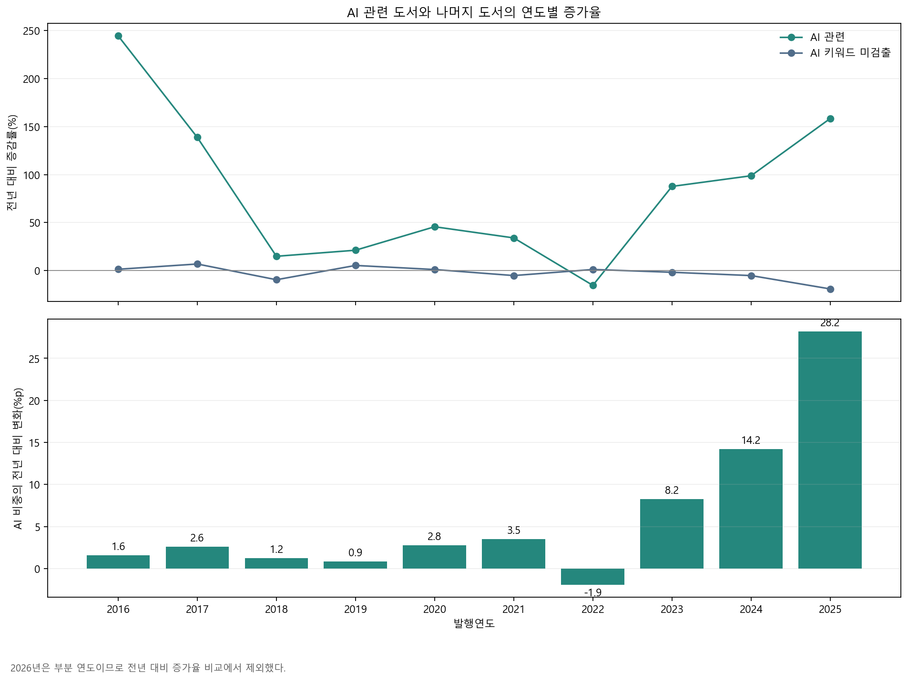
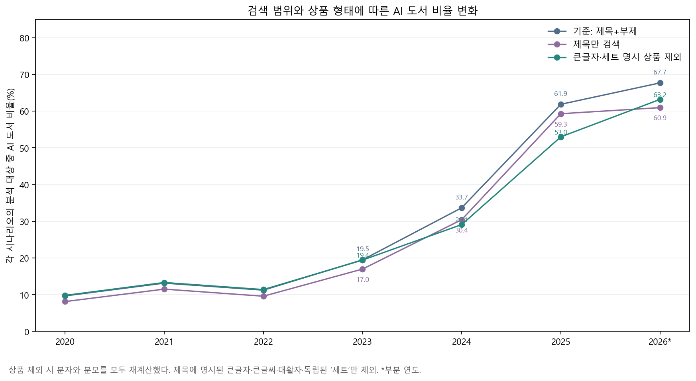

# IT 기술 트렌드의 논문-도서 반영 시차 분석

## 1. 개요

## 2. 데이터

### 2.1 현재 데이터 명세

| 항목 | 내용 |
|---|---|
| 파일 | `class3/data/yes24_it_mobile_list.csv` |
| 수집 대상 | 예스24 `국내도서 > IT 모바일` 및 하위 분류의 목록 상품 |
| 관측 단위 | 도서 상품 1개 |
| 수집일 | 2026-11-08 |
| 데이터 크기 | 46,081행, 18열 |
| 기본키 | `product_id`(중복 0건) |
| 발행월 범위 | 1980-01~2027-02 |

### 2.2 수집 컬럼

| 구분 | 컬럼 |
|---|---|
| 상품 식별 | `product_id`, `product_url` |
| 도서 정보 | `title`, `subtitle`, `contributors`, `publisher` |
| 발행 정보 | `publication_month`, `publication_date_raw` |
| 가격 정보 | `list_price`, `sale_price`, `discount_rate`, `points` |
| 독자 반응 | `average_rating`, `rating_count`, `sales_index` |

### 2.3 사용 컬럼

| 사용 목적 | 원본 컬럼 | 처리 방법 |
|---|---|---|
| 기술 주제 분류 | `title`, `subtitle` | 제목과 부제를 결합하여 기술 주제 판별 |
| 시간별 추세 | `publication_month` | 연도·월·분기 단위 집계 |

## 3. 본론

### 3.1 분석 기준

도서 제목과 부제를 결합한 뒤 키워드에 따라 일반·기술·서비스로 분류했다. 한 도서가 여러 분류에 동시에 포함될 수 있으며, 전체 AI 도서 수는 세 분류를 더한 값이 아니라 중복을 제거한 합집합이다.

| 분류 | 판정 기준 | 검색 키워드 |
|---|---|---|
| 전체 AI | 일반·기술·서비스 중 하나 이상에 해당 | 세 분류의 합집합 |
| 일반 | 인공지능을 통칭하는 표현이 있음 | 인공지능, Artificial Intelligence, AI, A.I. |
| 기술 | AI의 방법·구조·응용 기술을 가리키는 표현이 있음 | 생성형 AI, 머신러닝·기계학습, 딥러닝, LLM·거대/대규모 언어 모델, 신경망, 강화학습, 자연어 처리·NLP, 컴퓨터 비전, Transformer, RAG·검색 증강 생성, 프롬프트 엔지니어링, AI 에이전트·에이전틱 AI, 확산 모델 |
| 서비스 | 특정 AI 서비스·제품·모델명이 있음 | ChatGPT·GPT, Gemini, Claude, Copilot, Midjourney, Stable Diffusion, Suno, NotebookLM 등 |

‘일반’은 책의 난이도나 독자층을 뜻하지 않는다. 예를 들어 『AI와 ChatGPT』는 일반과 서비스에 모두 포함되지만 전체 AI에서는 1권으로 센다. 영문은 대소문자를 구분하지 않으며, 한글·영문 표기 변형과 오탐 방지 조건은 [키워드 사전](../ai_keywords.json)에 정의했다. 서비스 행은 대표 예시이며 전체 검색어도 이 사전에서 확인할 수 있다.

연도별 비교는 2010년부터 2026년까지를 대상으로 했다. 막대는 해당 연도의 관측값이고, 실선은 분류별 3년 후행 이동평균이다. 2026년은 1~11월만 포함한 부분 집계다.

발행월 누락 30건과 2026년 12월 이후 상품 15건을 제외한 46,036건을 분석 대상으로 삼았다. 2026년 수치는 11월 8일 수집 시점에 발행월이 1~11월로 표시된 상품으로, 11월 중 출간 예정 상품이 포함될 수 있다. 따라서 완결 연도와의 증가율 비교에서는 2026년을 제외한다. 아래 비율은 판매량이 아니라 현재 목록에 남아 있는 도서 상품 수를 기준으로 한다.

### 3.2 연도별 AI 관련 도서 수

전체 AI 관련 도서는 2023년 319권, 2024년 634권, 2025년 1,638권으로 증가했다. 2026년은 11월까지 1,799권이다.

### 3.3 연도별 AI 관련 도서 비율

전체 IT·모바일 도서 중 AI 관련 도서 비율은 2023년 19.5%, 2024년 33.7%, 2025년 61.9%로 증가했다. 2026년 부분 집계에서는 67.7%다.

### 3.4 AI 도서의 증가 속도는 나머지 도서와 다른가?

**목적:** AI 도서 비중 상승이 전체 IT 도서의 동반 성장 때문인지, AI 관련 상품 증가와 나머지 상품 감소가 함께 나타난 결과인지 확인한다.

**사용 데이터:** `title`, `subtitle`, `publication_month`로 계산한 연도별 전체·AI 도서 수. 그림은 2016~2025년이며 증가율 계산에는 직전 연도 자료도 사용했다.

**방법:** AI 관련 도서와 AI 키워드가 검출되지 않은 도서를 나누어 각각 전년 대비 증감률을 계산했다. 비중의 변화는 퍼센트포인트(%p)로 표시했다. 2026년은 완결 연도가 아니므로 증가율을 계산하지 않았다.

**결과:** AI 도서 증가율은 2023년 87.6%, 2024년 98.7%, 2025년 158.4%였다. 같은 기간 AI 키워드 미검출 도서는 각각 1.8%, 5.2%, 19.1% 감소했다. AI 비중의 상승 폭도 8.2%p, 14.2%p, 28.2%p로 커졌다. 2024~2025년 전체 상품은 765권 증가했는데, AI 상품은 1,004권 증가하고 나머지는 239권 감소했다.

**해석:** 최근 목록의 출간연도별 구성 변화는 전체 도서의 균등한 성장보다 AI 관련 상품 쪽에 집중되어 있다. 다만 AI 증가가 다른 책의 출간을 밀어냈다는 인과관계까지 확인한 것은 아니다. 과거 도서의 목록 잔존 여부도 영향을 줄 수 있다. 2016년의 높은 증가율은 2015년 9권에서 31권으로 늘어난 작은 분모의 영향이 크므로 최근의 대규모 증가와 구분해야 한다.

상세 수치: [연도별 증가율 CSV](analysis_results/ai_growth.csv)

### 3.5 일반·기술·서비스는 실제로 얼마나 겹치는가?

**목적:** 일반 도서 대부분이 기술·서비스와 겹치는지, 반대로 기술·서비스 도서에 일반 표현이 자주 함께 쓰이는지 구분한다.

**사용 데이터:** 발행월이 유효하고 2026년 11월 이하인 AI 키워드 일치 도서 5,274권의 세 분류 플래그. 이 절은 2010년 이전 도서도 포함한다.

**방법:** 세 플래그의 조합으로 서로 겹치지 않는 7개 집단을 만들었다. 조합별 비율의 분모는 전체 AI 5,274권이다. 별도로 조건부 중복률을 계산할 때는 질문의 기준이 되는 일반·기술·서비스 도서 수를 각각 분모로 사용했다.

**결과:** 일반에만 일치한 도서는 3,401권으로 전체 AI의 64.5%였다. 기술에만 일치한 도서는 655권(12.4%), 서비스에만 일치한 도서는 288권(5.5%)이었다. 두 분류 이상에 일치한 도서는 930권(17.6%)이었다.

일반 4,300권을 기준으로 보면 기술과의 중복은 523권(12.2%), 서비스와의 중복은 490권(11.4%)이다. 일반만 일치한 3,401권은 일반 전체의 79.1%다. 반면 기술 1,209권 중 일반과 겹친 비율은 43.3%, 서비스 809권 중 일반과 겹친 비율은 60.6%다.

**해석:** “기술·서비스 도서에서 일반 표현을 함께 쓴다”와 “일반 도서 대부분이 기술·서비스 도서다”는 서로 다른 주장이다. 현재 결과는 전자를 더 잘 뒷받침한다. 다만 ‘일반만’은 제목·부제에서 현재 사전의 기술·서비스명이 검출되지 않았다는 의미이며, 실제 내용이 비기술적이라는 뜻은 아니다.

상세 수치: [7개 조합 CSV](analysis_results/ai_overlap.csv), [분모별 중복률 CSV](analysis_results/ai_conditional_overlap.csv)

### 3.6 AI 도서 내부 구성은 어떻게 바뀌었는가?

**목적:** AI 도서 증가와 함께 기술 표현 중심에서 일반 표현이나 서비스명 중심으로 제목의 구성이 달라졌는지 확인한다.

**사용 데이터:** 2016~2026년 AI 도서의 연도와 세 분류 플래그. 분모는 해당 연도의 AI 도서 수이며 전체 IT 도서 수와는 다르다.

**방법:** 각 도서를 ‘일반만’, ‘기술 포함·서비스 없음’, ‘서비스 포함·기술 없음’, ‘기술·서비스 동시 포함’ 중 한 집단에 넣었다. 두 번째와 세 번째 집단은 일반 표현도 함께 포함할 수 있다. 네 집단의 합은 해당 연도 AI 도서 수와 같고, 비율 합은 100%다.

**결과:** 2018년에는 AI 85권 중 기술 포함·서비스 없음 집단이 73권(85.9%)이었다. 2023년에는 서비스 포함·기술 없음 집단이 126권(39.5%)으로 가장 컸다. 이후 일반만 집단은 2024년 384권(60.6%), 2025년 1,260권(76.9%)으로 커졌다. 2025년 기술 포함·서비스 없음 집단은 158권(9.6%), 서비스 포함·기술 없음 집단은 177권(10.8%)이었다.

2026년 부분 집계에서는 일반만 72.3%, 기술 포함·서비스 없음 11.1%, 서비스 포함·기술 없음 14.3%, 기술·서비스 동시 포함 2.3%였다.

**해석:** 현재 사전으로 관측한 변화는 기술 키워드가 중심이던 초기 구성, 2023년 서비스명 확대, 2024~2025년 일반 표현만 검출되는 상품의 대폭 증가 순서다. 이는 제목·부제의 구성 변화에 관한 결과다. 독자층의 대중화나 책의 기술적 깊이는 본문 자료 없이 단정할 수 없다. 큰글자책 등 상품 형태의 영향은 3.9절에서 별도로 확인한다.

상세 수치: [연도별 배타적 구성 CSV](analysis_results/ai_composition.csv)

### 3.7 기술 키워드의 중심은 어디로 이동했는가?

**목적:** AI 도서 전체의 확대 속에서 어떤 구체적인 기술 표현이 늘거나 줄었는지 살펴본다.

**사용 데이터:** 2016~2026년 기술 분류 도서의 `technical_keywords`. 분모는 해당 연도 기술 분류 도서 수이며 2018년 73권, 2025년 201권, 2026년 부분 집계 241권이다.

**방법:** 같은 책에서 같은 키워드가 반복되어도 키워드별 1권으로 셌다. 한 책이 여러 기술 키워드에 일치하는 것은 허용했다. 그림은 표시 기간의 누적 일치 도서 수 상위 10개 키워드이며, 색은 기술 분류 내 비율, 셀의 숫자는 권수와 비율이다. 전체 13개 기술 키워드는 CSV에 보존했다.

**결과:** 2018년 머신러닝은 43권(58.9%), 딥러닝은 36권(49.3%)이었다. 2025년에는 생성형 AI가 90권(44.8%), LLM이 45권(22.4%), AI 에이전트가 34권(16.9%), RAG가 24권(11.9%)이었다. 같은 해 머신러닝은 18권(9.0%), 딥러닝은 20권(10.0%)이었다.

2026년 부분 집계에서 AI 에이전트는 80권(33.2%), RAG는 30권(12.4%)으로 나타났다. LLM은 37권(15.4%)으로, 2025년과의 단순 연간 증감률 비교는 하지 않았다.

**해석:** 검출된 기술 표현의 중심이 머신러닝·딥러닝에서 생성형 AI, LLM, 에이전트, RAG로 넓어지는 흐름이 보인다. 기존 표현의 비율 감소는 해당 기술이 사라졌다는 뜻이 아니다. 새 책이 기존 기술을 다른 이름 아래 다룰 수 있으며, 제목에 표현이 없으면 현재 방식으로는 검출되지 않는다. 키워드별 비율을 더해 기술 도서 비중을 계산해서는 안 된다.

상세 수치: [기술·서비스 키워드별 연도 집계 CSV](analysis_results/ai_keyword_yearly.csv)

### 3.8 서비스 키워드는 특정 이름에 집중되어 있는가?

**목적:** AI 서비스 관련 도서가 ChatGPT 중심으로 유지되는지, 여러 서비스명을 다루는 방향으로 바뀌는지 확인한다.

**사용 데이터:** 2023~2026년 서비스 분류 도서의 `service_keywords`. 연도별 서비스 도서는 149권, 136권, 220권, 299권이며 마지막 해는 부분 집계다.

**방법:** ChatGPT와 GPT는 같은 책에 함께 검출되는 경우가 많아 이 절에서만 ‘ChatGPT/GPT’ 계열로 합쳐 한 권으로 셌다. 원래 세 분류 플래그는 유지했다. 다른 서비스 사이의 중복은 허용했다. 그림은 표시 기간 누적 일치 도서 수 상위 10개 계열이며 분모는 해당 연도의 서비스 분류 도서 수다.

**결과:** ChatGPT/GPT 계열은 2023년 서비스 도서 149권 중 139권(93.3%), 2024년 136권 중 119권(87.5%), 2025년 220권 중 157권(71.4%)에서 검출됐다. 2025년 Gemini는 26권(11.8%), Claude는 18권(8.2%), Midjourney는 22권(10.0%)이었다.

2026년 부분 집계에서는 Claude 107권(35.8%), Gemini 95권(31.8%), ChatGPT/GPT 91권(30.4%)이었다. Nano Banana 37권(12.4%), NotebookLM 35권(11.7%)도 확인됐다. 한 책이 여러 계열에 포함되므로 이 비율들의 합은 100%를 넘을 수 있다.

**해석:** 현재 목록에서 관측되는 서비스명은 초기 ChatGPT/GPT 중심에서 여러 이름으로 넓어지는 모습이다. 이는 책의 제목·부제에서 차지하는 비중이며 서비스 사용량이나 시장점유율은 아니다. GPT 계열의 모델명도 포함하므로 ChatGPT 서비스만의 수치로 해석해서는 안 된다. 현재 키워드 사전에 없는 서비스는 반영되지 않으며, 2026년 순위는 완결 연도 결과와 구분한다.

상세 수치: [기술·서비스 키워드별 연도 집계 CSV](analysis_results/ai_keyword_yearly.csv)

### 3.9 부제와 큰글자·세트 상품을 달리 처리해도 결과가 유지되는가?

**목적:** AI 도서 비중의 급증이 부제에서 추가로 찾은 책이나 같은 내용의 다른 상품 형태에 얼마나 민감한지 확인한다.

**사용 데이터:** 2020~2026년 전체 도서의 제목·부제·발행월과 AI 분류 결과.

**방법:** ① 제목+부제를 검색하는 기준 집계, ② 제목만 검색하는 집계, ③ 제목+부제를 검색하되 제목에 큰글자·큰글씨·대활자 또는 독립된 ‘세트’가 명시된 상품을 제외하는 집계를 비교했다. 세 번째에서는 제외된 상품을 분자와 분모에서 모두 뺐다. 두 조정을 동시에 적용한 결과는 아니며 각각 기준 집계와 비교했다.

**결과:** 2025년 기준 비율은 1,638/2,648권으로 61.9%다. 제목만 검색하면 1,570/2,648권으로 59.3%다. 큰글자·세트 명시 상품을 제외하면 전체 559권과 그중 AI 531권이 빠져 1,107/2,089권, 즉 53.0%다. 기준보다 8.9%p 낮다.

같은 상품 제외 기준에서 AI 비율은 2023년 19.4%, 2024년 29.1%, 2025년 53.0%로 상승했다. 따라서 최근의 증가 방향은 유지되지만 증가 폭에는 상품 형태의 영향이 있다. 2026년 부분 집계에서는 기준 67.7%, 제목만 검색 60.9%, 상품 제외 63.2%였다.

**해석:** 2025년 급증을 부제 검색만으로 설명하기는 어렵지만, 큰글자·세트 상품은 수치를 상당히 높인다. 현재 원자료의 관측 단위는 고유한 저작물이 아니라 상품이다. 제목에 상품 형태가 명시된 경우만 제외했으므로 이는 모든 판본의 중복 제거 결과가 아니다. 같은 책의 개정판·유사 제목·표기 없는 별도 판본은 남을 수 있다.

상세 수치: [민감도 분석 CSV](analysis_results/ai_sensitivity.csv)

## 4. 결론
