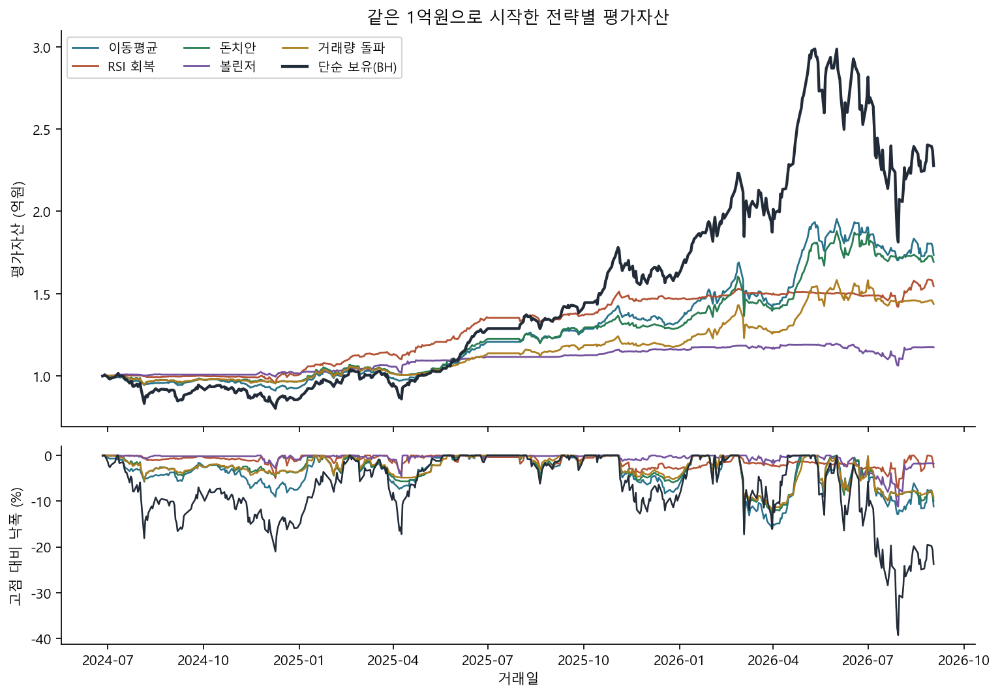
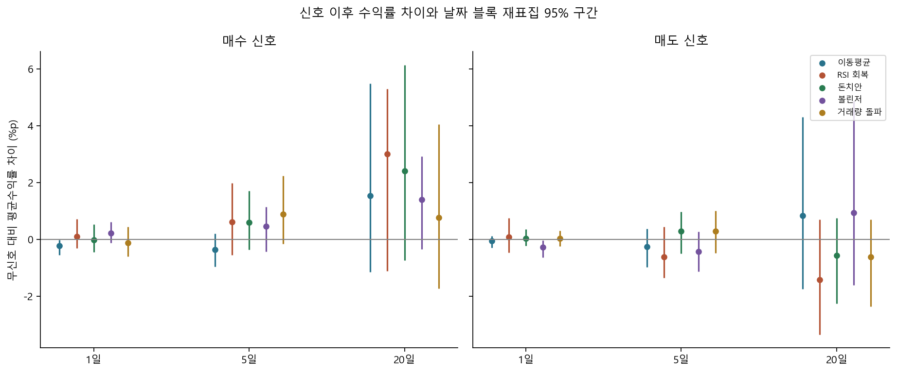
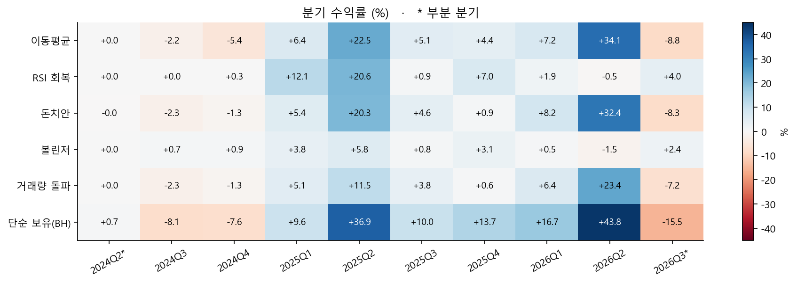

# 국내 50종목의 매매 신호와 모의매매 성과

**평가기간 2024-06-26~2026-09-02 · 532거래일 · 초기자금 전략당 1억원 · 편도 비용 0.15%**

단순 보유가 +127.72%로 전체 기간 수익률 1위였다. 능동 전략에서는 이동평균이 +73.41%로 가장 높았다. RSI의 최대 낙폭은 7.23%였고, BH는 39.30%였다. RSI의 평균 자금 투입률은 24.9%, BH는 96.9%다. 낙폭 차이에는 현금 보유 비중의 영향도 포함된다.

## 전체 기간 결과

|전략|진입/청산|왕복 거래|평균 이익|평균 손실|순손익(원)|수익률|BH 대비(%p)|MDD|
|---|---|---|---|---|---|---|---|---|
|이동평균|종가가 20일 평균 상향/하향 교차|999|+17.10%|-5.26%|+73,414,031|+73.41%|-54.30|16.80%|
|RSI 회복|RSI(14)가 30 상향/70 하향 교차|80|+41.93%|-13.82%|+54,526,647|+54.53%|-73.19|7.23%|
|돈치안|직전 20일 고가 돌파/10일 저가 이탈|272|+34.70%|-9.02%|+69,232,435|+69.23%|-58.49|14.88%|
|볼린저|20일 하단 재진입/중심선 회복|276|+7.55%|-7.67%|+17,384,926|+17.38%|-110.33|11.20%|
|거래량 돌파|돈치안 진입에 거래량 1.5배 조건 추가|220|+34.34%|-9.93%|+43,687,865|+43.69%|-84.03|13.92%|
|단순 보유(BH)|최초 매수/평가 종료 시 청산|50|+184.96%|-26.53%|+127,718,130|+127.72%|+0.00|39.30%|

## 신호가 방향을 구별했는가

아래 수치는 동일 날짜·동일 전략의 무신호 종목 평균에 대응시킨 값이다. 5일은 설명용 단면이고 그림에는 사전에 정한 세 기간을 모두 표시했다. 매도 신호는 음의 차이가 가설에 맞는다. 확률 열은 매수일 때 상승, 매도일 때 하락 확률이다. 보합은 별도 집계했다.

|전략|신호|건수|방향 확률 / 무신호|평균 수익률 / 무신호|평균 차이(%p)|95% 구간(%p)|
|---|---|---|---|---|---|---|
|이동평균|매수|1056|52.7% / 53.4%|+0.56% / +0.93%|-0.37|[-0.97, +0.20]|
|이동평균|매도|991|50.2% / 47.0%|+0.93% / +1.19%|-0.25|[-0.98, +0.37]|
|RSI 회복|매수|134|58.2% / 53.4%|+1.23% / +0.62%|+0.61|[-0.54, +1.98]|
|RSI 회복|매도|275|58.2% / 54.8%|-0.53% / +0.08%|-0.61|[-1.35, +0.44]|
|돈치안|매수|713|56.7% / 52.0%|+2.17% / +1.57%|+0.60|[-0.36, +1.72]|
|돈치안|매도|875|41.9% / 44.9%|+1.69% / +1.40%|+0.29|[-0.50, +0.97]|
|볼린저|매수|360|63.1% / 59.7%|+2.88% / +2.43%|+0.45|[-0.43, +1.14]|
|볼린저|매도|1178|48.0% / 45.9%|+0.31% / +0.74%|-0.43|[-1.13, +0.26]|
|거래량 돌파|매수|417|57.6% / 53.2%|+2.60% / +1.72%|+0.88|[-0.15, +2.24]|
|거래량 돌파|매도|875|41.9% / 44.9%|+1.69% / +1.40%|+0.29|[-0.49, +1.01]|

구간이 0을 포함하면 방향 우위를 확정하기 어렵다. 신호 수익률은 당일 종가부터, 모의매매는 다음 거래일 종가부터 측정한다. 같은 날짜의 종목은 함께 움직이고 20일 수익률은 서로 겹치므로 날짜 블록 단위로 재표집했다. 구간은 개별 비교 기준이며 다중 검정 보정은 적용하지 않았다. 30건 또는 5개 종목 미만은 탐색용이고, 20거래일보다 짧은 분기의 구간은 해석에서 제외한다.

## 분기별 성과

전체 기간 5거래일 기준으로 다섯 매수 신호와 다섯 매도 신호 모두 무신호 대비 평균 차이의 95% 구간이 0을 포함했다. 거래량 조건을 추가하면 5일 매수 신호의 수익률 차이는 +0.60%p에서 +0.88%p로 커졌지만, 매수 신호가 713건에서 417건으로 줄었다. 포트폴리오 전체 수익률도 돈치안 +69.23%에서 거래량 돌파 +43.69%로 낮아졌다.

완전한 분기 중 BH 수익률이 가장 낮았던 2024Q3에는 BH -8.08%, 이동평균 -2.19%, RSI +0.04%였다. 아래 분기별 손익은 종목별 현금과 보유 주식을 다음 분기로 이월한 결과다.

### 2024Q2 · 2024-06-26~2024-06-28 · 3거래일 (부분 분기)

|전략|진입/청산|왕복 거래|평균 이익|평균 손실|순손익(원)|수익률|BH 대비(%p)|MDD|
|---|---|---|---|---|---|---|---|---|
|이동평균|종가가 20일 평균 상향/하향 교차|0|—|—|+13,093|+0.01%|-0.66|0.01%|
|RSI 회복|RSI(14)가 30 상향/70 하향 교차|0|—|—|+0|+0.00%|-0.67|0.00%|
|돈치안|직전 20일 고가 돌파/10일 저가 이탈|0|—|—|-8,301|-0.01%|-0.68|0.01%|
|볼린저|20일 하단 재진입/중심선 회복|0|—|—|+9,281|+0.01%|-0.66|0.00%|
|거래량 돌파|돈치안 진입에 거래량 1.5배 조건 추가|0|—|—|+0|+0.00%|-0.67|0.00%|
|단순 보유(BH)|최초 매수/평가 종료 시 청산|0|—|—|+674,004|+0.67%|+0.00|0.14%|

### 2024Q3 · 2024-07-01~2024-09-30 · 62거래일

|전략|진입/청산|왕복 거래|평균 이익|평균 손실|순손익(원)|수익률|BH 대비(%p)|MDD|
|---|---|---|---|---|---|---|---|---|
|이동평균|종가가 20일 평균 상향/하향 교차|45|+3.07%|-6.57%|-2,188,897|-2.19%|+5.89|5.65%|
|RSI 회복|RSI(14)가 30 상향/70 하향 교차|0|—|—|+41,482|+0.04%|+8.12|1.10%|
|돈치안|직전 20일 고가 돌파/10일 저가 이탈|11|—|-14.57%|-2,337,735|-2.34%|+5.74|5.75%|
|볼린저|20일 하단 재진입/중심선 회복|9|+7.09%|-6.28%|+723,707|+0.72%|+8.80|0.72%|
|거래량 돌파|돈치안 진입에 거래량 1.5배 조건 추가|9|—|-17.03%|-2,316,278|-2.32%|+5.76|5.38%|
|단순 보유(BH)|최초 매수/평가 종료 시 청산|0|—|—|-8,134,920|-8.08%|+0.00|18.09%|

### 2024Q4 · 2024-10-02~2024-12-30 · 61거래일

|전략|진입/청산|왕복 거래|평균 이익|평균 손실|순손익(원)|수익률|BH 대비(%p)|MDD|
|---|---|---|---|---|---|---|---|---|
|이동평균|종가가 20일 평균 상향/하향 교차|81|+7.61%|-6.19%|-5,313,326|-5.43%|+2.21|7.18%|
|RSI 회복|RSI(14)가 30 상향/70 하향 교차|2|+28.88%|—|+341,236|+0.34%|+7.98|4.73%|
|돈치안|직전 20일 고가 돌파/10일 저가 이탈|21|+11.43%|-13.24%|-1,257,122|-1.29%|+6.36|2.58%|
|볼린저|20일 하단 재진입/중심선 회복|31|+5.25%|-2.68%|+856,331|+0.85%|+8.49|2.85%|
|거래량 돌파|돈치안 진입에 거래량 1.5배 조건 추가|15|+11.97%|-18.04%|-1,222,721|-1.25%|+6.39|2.49%|
|단순 보유(BH)|최초 매수/평가 종료 시 청산|0|—|—|-7,073,180|-7.64%|+0.00|14.87%|

### 2025Q1 · 2025-01-02~2025-03-31 · 58거래일

|전략|진입/청산|왕복 거래|평균 이익|평균 손실|순손익(원)|수익률|BH 대비(%p)|MDD|
|---|---|---|---|---|---|---|---|---|
|이동평균|종가가 20일 평균 상향/하향 교차|171|+13.70%|-4.63%|+5,891,851|+6.37%|-3.22|5.99%|
|RSI 회복|RSI(14)가 30 상향/70 하향 교차|22|+38.51%|-6.72%|+12,177,809|+12.13%|+2.54|1.71%|
|돈치안|직전 20일 고가 돌파/10일 저가 이탈|52|+20.30%|-7.24%|+5,230,154|+5.43%|-4.16|4.72%|
|볼린저|20일 하단 재진입/중심선 회복|46|+7.39%|-3.36%|+3,818,537|+3.76%|-5.83|1.07%|
|거래량 돌파|돈치안 진입에 거래량 1.5배 조건 추가|46|+20.01%|-6.69%|+4,881,415|+5.06%|-4.53|4.35%|
|단순 보유(BH)|최초 매수/평가 종료 시 청산|0|—|—|+8,196,020|+9.59%|+0.00|9.75%|

### 2025Q2 · 2025-04-01~2025-06-30 · 60거래일

|전략|진입/청산|왕복 거래|평균 이익|평균 손실|순손익(원)|수익률|BH 대비(%p)|MDD|
|---|---|---|---|---|---|---|---|---|
|이동평균|종가가 20일 평균 상향/하향 교차|60|+5.20%|-3.89%|+22,188,312|+22.55%|-14.32|1.79%|
|RSI 회복|RSI(14)가 30 상향/70 하향 교차|7|+18.50%|-26.71%|+23,144,111|+20.56%|-16.30|2.87%|
|돈치안|직전 20일 고가 돌파/10일 저가 이탈|12|+17.98%|-9.81%|+20,587,893|+20.26%|-16.61|1.17%|
|볼린저|20일 하단 재진입/중심선 회복|45|+8.59%|-6.69%|+6,082,368|+5.77%|-31.09|3.82%|
|거래량 돌파|돈치안 진입에 거래량 1.5배 조건 추가|9|+17.98%|-10.12%|+11,667,278|+11.51%|-25.35|0.84%|
|단순 보유(BH)|최초 매수/평가 종료 시 청산|0|—|—|+34,528,170|+36.86%|+0.00|9.88%|

### 2025Q3 · 2025-07-01~2025-09-30 · 65거래일

|전략|진입/청산|왕복 거래|평균 이익|평균 손실|순손익(원)|수익률|BH 대비(%p)|MDD|
|---|---|---|---|---|---|---|---|---|
|이동평균|종가가 20일 평균 상향/하향 교차|50|+39.70%|-2.74%|+6,131,140|+5.08%|-4.96|4.85%|
|RSI 회복|RSI(14)가 30 상향/70 하향 교차|11|+63.31%|-7.50%|+1,262,635|+0.93%|-9.11|2.83%|
|돈치안|직전 20일 고가 돌파/10일 저가 이탈|21|+44.04%|-7.27%|+5,574,536|+4.56%|-5.48|4.45%|
|볼린저|20일 하단 재진입/중심선 회복|12|+4.01%|-1.15%|+870,825|+0.78%|-9.26|0.21%|
|거래량 돌파|돈치안 진입에 거래량 1.5배 조건 추가|14|+41.09%|-7.64%|+4,313,359|+3.82%|-6.23|3.16%|
|단순 보유(BH)|최초 매수/평가 종료 시 청산|0|—|—|+12,872,820|+10.04%|+0.00|6.19%|

### 2025Q4 · 2025-10-01~2025-12-30 · 59거래일

|전략|진입/청산|왕복 거래|평균 이익|평균 손실|순손익(원)|수익률|BH 대비(%p)|MDD|
|---|---|---|---|---|---|---|---|---|
|이동평균|종가가 20일 평균 상향/하향 교차|119|+23.75%|-3.59%|+5,523,837|+4.36%|-9.34|8.33%|
|RSI 회복|RSI(14)가 30 상향/70 하향 교차|7|+107.07%|-10.09%|+9,613,617|+7.02%|-6.68|3.80%|
|돈치안|직전 20일 고가 돌파/10일 저가 이탈|21|+72.10%|-7.26%|+1,140,609|+0.89%|-12.81|5.92%|
|볼린저|20일 하단 재진입/중심선 회복|26|+8.78%|-1.20%|+3,431,735|+3.05%|-10.65|1.22%|
|거래량 돌파|돈치안 진입에 거래량 1.5배 조건 추가|17|+60.66%|-6.85%|+648,163|+0.55%|-13.15|5.24%|
|단순 보유(BH)|최초 매수/평가 종료 시 청산|0|—|—|+19,329,670|+13.70%|+0.00|12.72%|

### 2026Q1 · 2026-01-02~2026-03-31 · 59거래일

|전략|진입/청산|왕복 거래|평균 이익|평균 손실|순손익(원)|수익률|BH 대비(%p)|MDD|
|---|---|---|---|---|---|---|---|---|
|이동평균|종가가 20일 평균 상향/하향 교차|212|+14.36%|-6.29%|+9,462,203|+7.16%|-9.59|16.80%|
|RSI 회복|RSI(14)가 30 상향/70 하향 교차|7|+36.46%|—|+2,746,226|+1.87%|-14.87|2.36%|
|돈치안|직전 20일 고가 돌파/10일 저가 이탈|61|+18.15%|-9.01%|+10,524,581|+8.16%|-8.58|14.88%|
|볼린저|20일 하단 재진입/중심선 회복|34|+6.57%|-4.32%|+615,877|+0.53%|-16.21|1.88%|
|거래량 돌파|돈치안 진입에 거래량 1.5배 조건 추가|56|+18.36%|-9.70%|+7,567,210|+6.41%|-10.33|13.92%|
|단순 보유(BH)|최초 매수/평가 종료 시 청산|0|—|—|+26,860,400|+16.75%|+0.00|17.25%|

### 2026Q2 · 2026-04-01~2026-06-30 · 61거래일

|전략|진입/청산|왕복 거래|평균 이익|평균 손실|순손익(원)|수익률|BH 대비(%p)|MDD|
|---|---|---|---|---|---|---|---|---|
|이동평균|종가가 20일 평균 상향/하향 교차|108|+12.49%|-3.91%|+48,390,098|+34.15%|-9.70|9.08%|
|RSI 회복|RSI(14)가 30 상향/70 하향 교차|2|+12.64%|—|-703,155|-0.47%|-44.32|1.71%|
|돈치안|직전 20일 고가 돌파/10일 저가 이탈|28|+29.96%|-8.52%|+45,115,170|+32.35%|-11.50|8.64%|
|볼린저|20일 하단 재진입/중심선 회복|23|+7.76%|-8.16%|-1,723,151|-1.48%|-45.33|4.94%|
|거래량 돌파|돈치안 진입에 거래량 1.5배 조건 추가|22|+50.58%|-11.01%|+29,344,330|+23.37%|-20.48|7.79%|
|단순 보유(BH)|최초 매수/평가 종료 시 청산|0|—|—|+82,110,050|+43.85%|+0.00|16.39%|

### 2026Q3 · 2026-07-01~2026-09-02 · 44거래일 (부분 분기)

|전략|진입/청산|왕복 거래|평균 이익|평균 손실|순손익(원)|수익률|BH 대비(%p)|MDD|
|---|---|---|---|---|---|---|---|---|
|이동평균|종가가 20일 평균 상향/하향 교차|153|+22.35%|-6.82%|-16,684,281|-8.78%|+6.68|10.61%|
|RSI 회복|RSI(14)가 30 상향/70 하향 교차|22|+16.70%|-15.09%|+5,902,685|+3.97%|+19.43|5.71%|
|돈치안|직전 20일 고가 돌파/10일 저가 이탈|45|+68.36%|-7.69%|-15,337,350|-8.31%|+7.15|9.58%|
|볼린저|20일 하단 재진입/중심선 회복|50|+9.81%|-14.90%|+2,699,416|+2.35%|+17.81|7.65%|
|거래량 돌파|돈치안 진입에 거래량 1.5배 조건 추가|32|+86.15%|-8.68%|-11,194,892|-7.23%|+8.23|9.80%|
|단순 보유(BH)|최초 매수/평가 종료 시 청산|50|+184.96%|-26.53%|-41,644,903|-15.46%|+0.00|35.61%|

분기 수익률에는 미실현 평가손익도 포함한다. 거래 수와 평균 이익·손실은 청산 분기에 귀속하므로 BH는 중간 분기에 거래가 없어도 수익률이 변한다. ‘—’는 해당 거래가 없다는 뜻이다.

## 거래비용 민감도

|전략|편도 0%|편도 0.15%|편도 0.30%|기준 투입률|기준 총비용(원)|
|---|---|---|---|---|---|
|이동평균|+84.41%|+73.41%|+64.84%|50.3%|7,317,554|
|RSI 회복|+55.30%|+54.53%|+53.65%|24.9%|636,513|
|돈치안|+71.64%|+69.23%|+66.64%|38.4%|2,022,615|
|볼린저|+19.25%|+17.38%|+15.97%|11.4%|1,762,334|
|거래량 돌파|+45.41%|+43.69%|+42.22%|29.4%|1,472,325|
|단순 보유(BH)|+128.64%|+127.72%|+127.18%|96.9%|480,310|

## 자료와 해석 범위

매수 가설은 이동평균의 추세 지속, RSI의 과매도 반등, 돈치안의 신고가 추세, 볼린저의 평균 회귀, 거래량 돌파의 거래량 확인이다. 거래비용은 실제 세율이 아닌 동일 조건의 실험값이다. 현재 파일에는 보통주·ETF 등 상품 유형 구분이나 수정주가 마스터가 없으므로 종목 유형별 해석은 유보한다.

- 전체 4,813개 코드 중 최초 60시장일에 유효 거래가 50일 이상인 코드에서 유효일 평균 거래대금 상위 50개를 고정했다. 상품 유형 혼합을 허용했다. 50개 종목은 각 200만원 독립 계정으로 운용했다. 성과는 이 표본의 가격수익이며 배당·현금이자는 제외했다.
- exchange_calendars 4.13.3의 XKRX와 [코스피 일봉](https://fchart.stock.naver.com/sise.nhn?symbol=KOSPI&timeframe=day&count=1200&requestType=0)을 대조했다. 2026-07-17은 지수 관측이 없어 제외했다. 분석 캘린더 592일 중 원자료에 어떤 종목도 없는 날이 42일이다. 해당 날에는 거래하지 않고 보유가는 마지막 유효 종가로 평가했다. 가격 공백은 낙폭을 작게 보이게 할 수 있다.
- 매수는 다음 시장일에 체결 불가하면 취소하고, 매도는 유효 종가까지 대기했다. 신호는 연속 22개 유효 관측이 있는 공통 표본에서 계산했다. 거래량 돌파는 직전 20일 평균 거래량의 1.5배 조건을 추가한다. 주 결과는 현금 보유를 허용하는 정수 주식 매매이며, 마지막 날 모든 전략의 잔여 포지션이 청산됐다.
- 확인된 [LS ELECTRIC 액면분할](https://www.ls-electric.com/ko/company/invest/data/%EC%A3%BC%EC%8B%9D%EB%B6%84%ED%95%A0%EA%B3%B5%EA%B3%A0_260326.pdf)과 [에이피알 액면분할](https://kind.krx.co.kr/external/2024/10/30/000411/20241030000939/99322.htm)은 1→5주로 처리했다. [가온전선 무상증자](https://kind.krx.co.kr/external/2026/06/16/000492/20260616001141/11307.htm)는 권리락일부터 1주당 0.8주를 반영하고 단수는 상장일 종가로 정산했다. 전량 청산 규칙 때문에 신주 상장 전에는 권리가 있는 포지션 전체의 매도를 보류했다. 이는 보수적인 모형 가정이다.
- 급변 점검 파일에는 두 유효 종가 사이에 결측일이 끼어 있는 경우와 부동소수점 오차로 정확히 30%인 경우도 들어 있다. 기업행동 전수 마스터와 공식 수정주가 전체를 대조한 결과는 아니므로 원화 금액은 모의 추정값이다. 실제 재현 수익, 일반 주식 전체의 성과, 향후 수익을 뜻하지 않는다.

[신호별·분기별 상세](signal_results.csv) · [전체/분기 전략 지표](strategy_results.csv) · [종목 선정](universe.csv) · [거래 장부](trades.csv) · [일별 자산](daily_equity.csv) · [결측·급변](exclusions.csv) · [달력](calendar.csv) · [입력 해시](inventory.csv) · [사전 계획](../STRATEGY_STUDY_PLAN.md)
